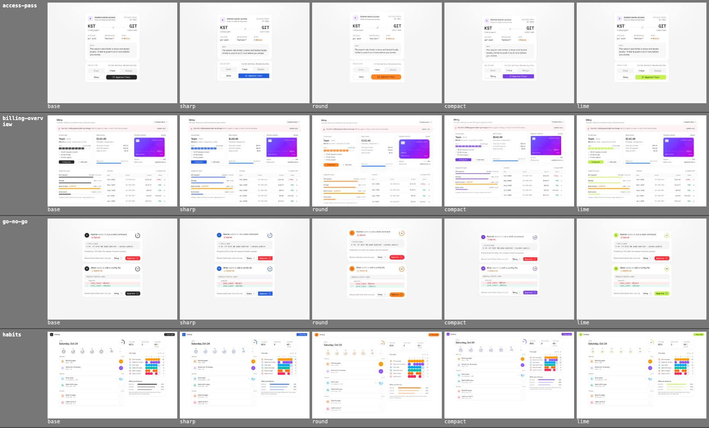
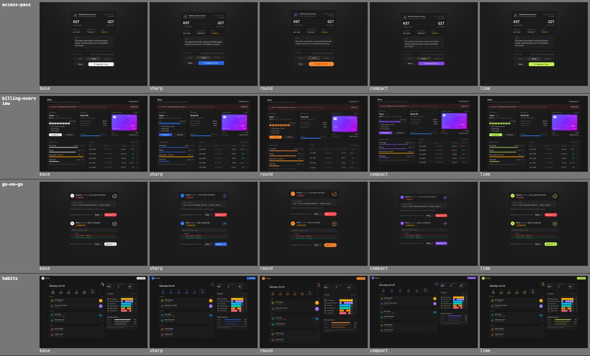

# Theme customiser audit

The customiser (palette button in the header, and on every item stage) re-themes every preview live: primary colour, corner radius, density and font. It writes CSS variables to `[data-theme-scope]` (library tiles, the landing stage) and to the `/preview/<slug>` iframes, saves the choice per browser, and copies it out as CSS variables or as a shadcn `registry:theme` (`npx shadcn add https://devl.dev/api/theme/<code>.json`).

This file records how all 269 items were checked against it, what broke, and what changed.

## Knobs

| Knob | Variables | Range | Why this range |
| --- | --- | --- | --- |
| Colour | `--primary`, `--primary-foreground`, `--ring`, `--sidebar-primary(-foreground)`, `--sidebar-ring`, `--brand`, `--brand-foreground`, `--brand-ink` | devl neutral, 7 curated colours, any hue | Light/dark pairs are computed so white text on primary is at least 5.4:1 (light) / 4.8:1 (dark). Pale hues (lime, amber, orange) get dark text instead. Items lean on `text-primary-foreground/70` and similar, so the headroom matters. |
| Radius | `--radius` (and with it `rounded-xs` … `rounded-4xl`, plus bare `rounded`) | 0 – 1rem, 8 stops | Above 1rem, `rounded-3xl` and `rounded-4xl` reach 35px or more on small cards, and nested panels start to poke out. |
| Density | `--spacing` | compact 0.225rem, default 0.25rem, comfy 0.275rem (±10%) | Tailwind v4 drives padding, gaps, sizes and widths from `--spacing`, so this scales everything except type. Going past ±10% starts to truncate text in fixed-width columns. |
| Font | `--font-sans`, `--font-heading` | Inter, Geist, Figtree, Space Grotesk, system | All within ±5% of Inter's set width (measured), so they don't reflow layouts. They load only when picked (`preload: false`). |

Left out on purpose:

- **Neutrals and surfaces** (`--background`, `--card`, `--muted`, borders). Items draw identity colours (avatars, labels, statuses, illustrations) as named hues tuned against the coss neutrals. Tinting the neutrals would quietly lower their contrast across ~120 items.
- **Semantic colours** (`--destructive`, `--success`, `--warning`, `--info`). They carry meaning, not brand.
- **Chart colours.** coss swaps chart hues between light and dark on purpose, and bklit charts use their own palette.
- **Font size or type scale.** Screens have fixed heights (`h-[760px]`), and scaling text breaks them far more than spacing does.
- **Mono and serif fonts.** Items use `font-mono` for code and figures, which stays Geist Mono.

## Method

`scripts/theme-audit.mjs` loads every `/preview/<slug>?theme=<mode>&custom=<theme>` in headless Chrome (reduced motion, so demos settle) under five themes:

| Theme | Code | What it stresses |
| --- | --- | --- |
| base | devl default | the reference |
| sharp | `blue_263_0_default_geist` | radius 0, saturated primary with white text |
| round | `orange_41_1_comfy_figtree` | radius 1rem, +10% spacing, pale primary with dark text |
| compact | `violet_293_0.375_compact_space-grotesk` | −10% spacing, a display font with different glyph shapes |
| lime | `lime_124_0.625_default_inter` | the lightest primary, dark text on it |

Each theme ran in light and dark at the item's natural size, plus base and round on a 390px phone: 12 shots per item, 3,228 per run. In every shot the script reads the DOM and compares it with base in the same mode:

- **contrast**: any text whose contrast drops below 3:1 when it was at least 3:1 in base. It composites the real background stack.
- **corner**: under `sharp`, any painted element that still has a radius and isn't a circle or pill.
- **clips**: text that newly overflows its box.
- **overflow**: the page newly scrolls sideways.
- **errors**: page errors.

`scripts/theme-sheets.mjs` builds contact sheets (one row per item, the five themes side by side). Four independent reviewers went through all 136 sheets for what the DOM checks can't see: colour clashes, things that should follow the brand colour but don't, and layout damage. Every finding was checked against the full-size shots.

## Results

| Check | Run 1 (before) | Final run | Left over |
| --- | --- | --- | --- |
| Page errors | 0 | 0 | |
| Contrast below 3:1 | 1 item (rim-light) | 0 | |
| Corners still rounded at radius 0 | 60 items | 9 items | All intentional, see below |
| Page scrolls sideways | 1 item | 1 item | drip-badge, 0.6px at 390px + comfy |
| New text truncation | 34 items | 23 items | All ellipsis or line-clamp, by design |
| Visual review findings | 36 items | 0 open | handoff-card is a pre-existing bug, see below |

Run 1 ran on the items as they are on `main`, with the customiser in place. The pricing-table glow and coss badge/kbd/checkbox changes landed partway through it. The final run is a full re-run of all 269 items after the fixes, plus a re-shoot of the items changed while it ran. Three reviewer flags turned out not to be breaks: status-console and launcher scroll their content under comfy, and assistant-start's Search chip uses the semantic `info` colour, as in base.




More samples: `docs/theme-audit/sample-light-2.jpg` and `sample-dark-2.jpg`. The customiser itself: `docs/theme-audit/panel-*.jpg`.

## What broke, by cause

### 1. Primary and foreground used as if they were the same (systemic, ~25 items)

In devl's default theme `--primary` *is* `--foreground` (neutral-800 in light, neutral-100 in dark). So items mixed them freely: checked controls, progress fills and app logo marks used `bg-foreground text-background`. A blue theme then turned the button blue while the checkbox next to it stayed black. The reverse happened too: identity colours (a file-type badge, third-party app icons) used `bg-primary` and collided with real brand surfaces.

Fix: intent-based swaps. All of them are pixel-identical at the default, because the two tokens resolve to the same colour there.

- **To primary** (controls, progress, brand marks): admin-users seats meter; accounts-crm forecast meter; billing-overview seats and usage bars; cart-drawer shipping progress; checkout-summary radio; conductor progress and selected chips; drive logo and storage meter; first-run step dot and progress; folder-view logo; habits rings and best-time bar; intake-survey progress and selected option; music-player progress; order-tracker progress and steps; settings-and-plans usage meter; sign-in and sign-up logo; split-shell logo; star-and-emoji-rating dot; status-console logo; swatch-card selected size; team-roles checkbox; waitlist progress.
- **Away from primary** (identities): upload-tray VID badge and connector-marketplace neutral app icons now use `bg-foreground`.
- **Contrast**: rim-light's "Live" pill used `text-brand-foreground` on `bg-brand/24`, which is 1.4:1 on blue. It now uses `text-brand-ink`, the token made for text on light surfaces.
- **Glow**: pricing-table's featured card layered `bg-info` and `bg-success` blurs over primary, which looked muddy on orange and lime. They are now `primary-foreground` tints.
- **Dots**: week-agenda's event dots vanished on a blue or violet selected day. They now use `primary-foreground` on the selected day.

Left alone on purpose: navigation indicators, carets, playheads, tooltips and counters stay `foreground` (neutral), the same as coss's own Tabs. Fixed `info` accents in billing-overview, assistant-start, conveyor and delivery-tracker stay, because they are semantic colours and match base.

### 2. Radius that ignored `--radius` (systemic, 60 items)

- **Bare `rounded` and `rounded-xs`** compiled to Tailwind's fixed `0.25rem` and `0.125rem`. `globals.css` now maps both onto the theme radius (`calc(var(--radius) * 0.4)`, still 4px at the default). This covers 192 uses across items plus coss's checkbox, badge and kbd, whose `rounded-[.25rem]` now uses `rounded-xs`.
- **Arbitrary px radii** (`rounded-[10px]`, `rounded-[3px]` and so on) in 55 items. Each one maps exactly onto the scale at the default: 6, 8, 10, 14 and 18px become `rounded-sm`, `-md`, `-lg`, `-xl` and `-2xl`; 2, 3, 4 and 5px become `rounded-[calc(var(--radius)*0.2…0.5)]`. These forms work in any shadcn or coss project, so installed copies follow the user's radius too. Nothing moves at the default.
- **Motion layout radii.** go-no-go, connector-search, drive, launcher, lift-to-open and video-call set `style={{ borderRadius: 16 }}` so motion can correct corners during layout animations, and motion only corrects px or % values. Each now reads the live radius through a tiny probe (`useThemeRadius`: an invisible span sized `calc(var(--radius) * k)`, watched with ResizeObserver). Motion still gets px, and the value follows theme changes live.
- **Others**: article-cards' nested radius now derives from `--radius-2xl`. liquid-checkbox caps its size-relative radius at `--radius`. habits' week cells cap at `min(--radius-md, 2 spacing)` so they stay squares (the copy says "tap a square") and their fill inherits the radius.
- **Kept on purpose (the 9 left)**: physical objects keep their shape (card-stack, envelope, flip-clock, departures' split flaps, server-rack, swatch-card's paint tube, folder-view's diamond icon). theme-studio has its own radius control and previews that, not the page's. bklit-heatmap-chart's legend squares come from the bklit library.

### 3. Fixed px geometry next to spacing-based layout (density, 7 items)

`--spacing` scales Tailwind's padding, gaps and sizes. Anything measured in px or rem beside them drifts apart under compact or comfy:

| Item | What broke | Fix |
| --- | --- | --- |
| video-call | Tile widths hard-coded a `0.5rem` gap, so at comfy three tiles no longer fit a row and the grid collapsed into two overlapping columns | Gap in the calc reads `var(--spacing) * 2` |
| branch-graph | SVG rows use `ROW = 36px` but rows were `h-9`, so nodes drifted off their commits | Row height uses the same `ROW` constant |
| habits | 380px sidebar holding spacing-sized cells overflowed at comfy | `--spacing(95)` column, `max-w-30` names |
| departures | `max-w-[600px]` card with spacing-sized flaps overflowed at comfy | `max-w-150` |
| range-calendar | `max-w-[640px]` popover clipped the second month at comfy | `max-w-160` |
| project-pulse | `w-[440px]` card; avatars overlapped the due date at comfy | `w-110` |
| versus-table | Checks revealed `whileInView` with `amount: 1`; fractional comfy offsets kept them from ever being 100% visible | `amount: 0.5` |

All of these are exact at the default density. 195 other `max-w-[Npx]` caps were left as written: they caused no breakage, and they're the owner's documented widths.

### 4. Truncation

colour-field's hint was hard-clipped because `truncate` sat on a flex row. The text now lives in its own truncating span. The 23 items still listed truncate with an ellipsis or line-clamp when compact or comfy squeezes a fixed column. That is the designed behaviour, so it isn't counted as a break.

### 5. Fonts

DM Sans was the first pick for the round preset, but it has no tabular figures, so the rolling numbers in dashboard-header, coupon-field, metric-card, sales-overview, odometer, phase-builder and pricing-table rendered as "$1 01,220". Figtree replaced it: it has real tabular figures and a similar width.

## Unresolved

- **drip-badge**: the goo filter canvas reaches 0.6px past a 390px viewport at comfy, which creates a 1px horizontal scroll in the bare preview. It's decorative, and I didn't clip the goo.
- **handoff-card** (pre-existing, not theme-related): in the accepted state, the "Accept handoff" button stays on top of the "Undo" notice row. At the default it hides because both are near-black. Worth its own fix.
- **Installed copies** pick up everything above except the bare `rounded` and `rounded-xs` mapping, which lives in devl's `globals.css`. Those corners stay 4px and 2px in a user's project unless they add the same two lines to `@theme inline`.
- **Portals on library tiles**: tiles render inline, and a popover from a tile portals to `<body>`, outside the themed scope. The detail page iframe has no such gap.

## Re-running

```bash
SHOTS_URL=http://localhost:3418 node scripts/theme-audit.mjs            # all items, or pass slugs
node scripts/theme-sheets.mjs 4                                         # contact sheets in .shots/theme/sheets
SHOTS_URL=http://localhost:3418 node scripts/theme-showcase.mjs docs/theme-audit
```
